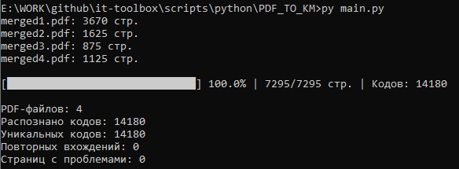

# Скрипт для распознавания PDF файлов честного знака в коды маркировки

## Причина написания скрипта

На сайте ГИС МТ, нет возможности скачать полноценные коды маркировки **с криптохвостом**. 
У вас есть возможность скачать по 500 кодов с PDF либо до 2000 eps печатью.

## Требования

Установите компоненты:
```
py -m pip install pymupdf numpy zxing-cpp
```

## Использование
Поместите ваши PDF файлы с маркировками в каталог ```import```, запустите скрипт ```py main.py```


